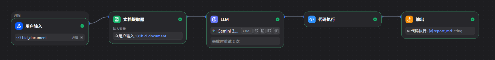

# AI 智能标书审查助手

## 一、项目简介

本项目基于 Dify 工作流平台构建，利用大语言模型实现招标文件内容提取、智能分析与结果输出，探索 AI 在招投标文件审查场景中的应用。

项目通过可视化工作流连接用户输入、文档提取器、LLM、代码执行和输出节点，便于工作流维护、复用与迭代。

## 二、核心功能

- 支持用户上传招标文件
- 使用文档提取器提取文件内容
- 调用大语言模型分析文档内容
- 通过代码执行节点处理分析结果
- 输出处理后的分析结果

具体审查维度和报告内容以实际工作流配置与测试结果为准。

## 三、技术栈

| 技术 | 用途 |
|---|---|
| Dify | AI 应用开发与工作流编排 |
| LLM | 文档理解与内容分析 |
| 文档提取器 | 提取上传文件的文本 |
| 代码执行节点 | 处理模型输出 |
| GitHub | 项目配置管理与作品展示 |

## 四、工作流设计

当前工作流的主要流程：

用户输入 → 文档提取器 → LLM → 代码执行 → 输出

### 节点说明

1. 用户输入：接收上传的招标文件。
2. 文档提取器：提取文件中的文本内容。
3. LLM：根据提示词分析提取后的文档。
4. 代码执行：对分析结果进行处理。
5. 输出节点：返回最终处理结果。

### 工作流截图

## 五、项目文件

- `README.md`：项目说明与操作指南。
- `AI智能标书审查助手.yml`：Dify 导出的应用 DSL 配置文件。
- [测试案例.md](测试案例.md)：记录测试输入、实际运行结果与测试结论。
  
## 六、如何导入和运行

1. 准备可用的 Dify 环境。
2. 在 Dify 中找到 DSL 导入功能。
3. 选择本仓库中的 `AI智能标书审查助手.yml`。
4. 导入后检查 LLM、文档提取器、代码执行和输出节点的配置。
5. 根据实际使用情况配置模型及必要的凭证。
6. 使用测试招标文件运行工作流，检查最终输出结果。

注意：导入工作流后可能仍需配置模型、插件或其他依赖，具体以实际环境为准。

## 七、安全说明

- 不要上传真实 API Key、访问令牌、密码等敏感信息。
- 不要将未经授权的招标文件、客户资料或内部信息公开。
- 对 AI 生成的分析结果进行人工复核。
- 对外展示前检查 DSL 文件和测试截图中是否包含敏感信息。

## 八、后续计划

- 优化招标文件审查提示词。
- 增加测试案例并记录运行结果。
- 优化分析报告的结构和可读性。
- 添加 Dify 工作流截图与运行效果展示。
- 持续改进工作流的异常处理能力。

---

本项目用于 Dify 工作流开发学习与作品展示。实际效果取决于模型、提示词、文件质量和具体配置。
